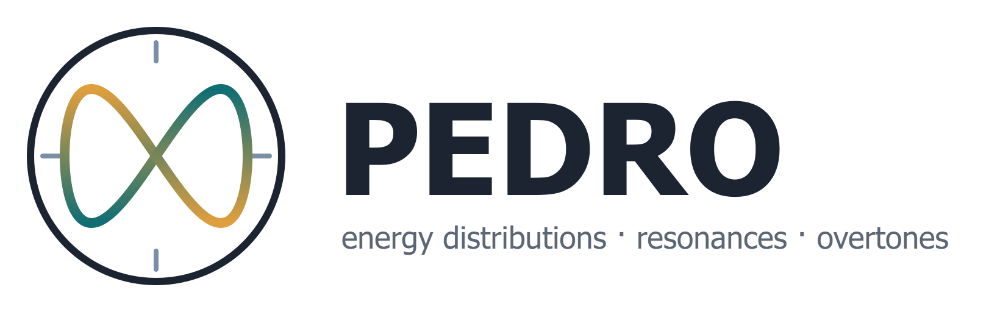
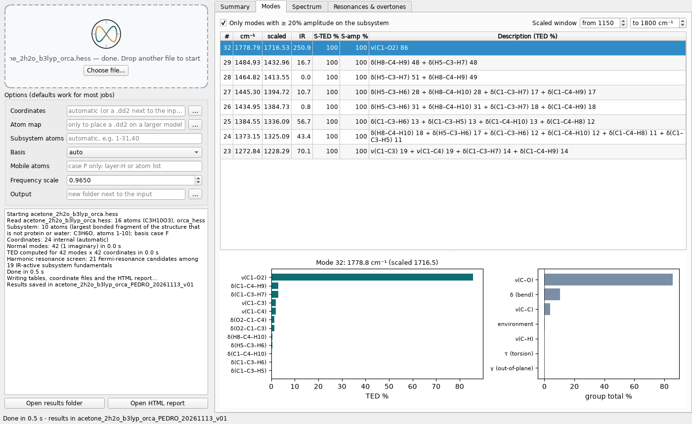
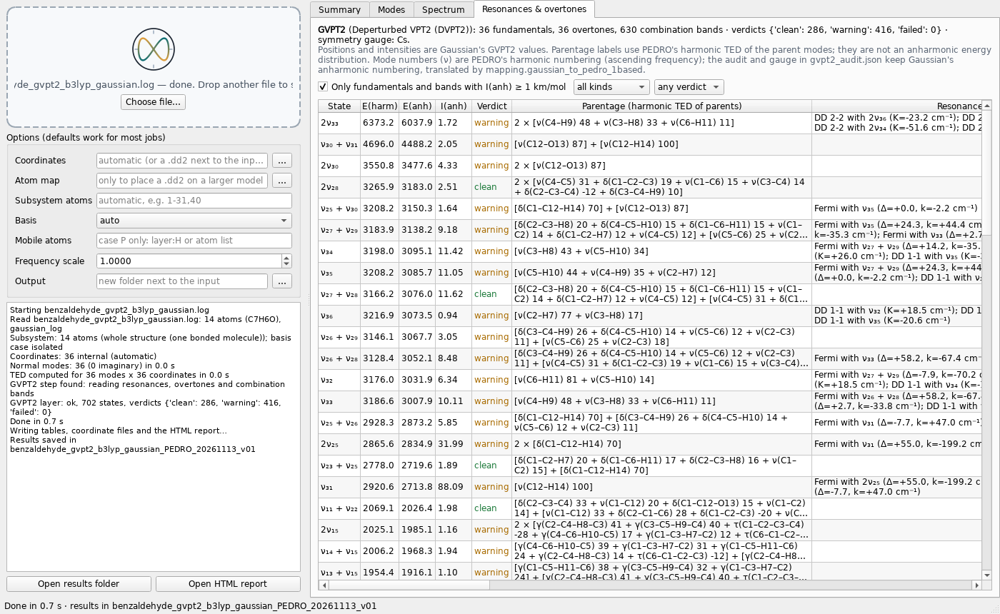

<p align="center">
  <picture>
    <source media="(prefers-color-scheme: dark)" srcset="branding/lockup_dark.png">
    
  </picture>
</p>

**PEDRO** (Potential Energy Distributions with Resonances and Overtones) assigns **harmonic vibrational modes of
molecules embedded in large ONIOM and QM/MM models**. It reads a completed frequency calculation's Cartesian
Hessian and describes the target molecule in bond stretches, bends, torsions and out-of-plane motions, retaining
the full model's coupling to its environment. Potential- and total-energy distributions (PED and TED), isolated
molecule comparisons and optional Gaussian GVPT2 analysis are also available.

**Beta 0.2.0b1.** The main workflow is harmonic embedded-molecule assignment. Inspect the selected subsystem,
coordinate set and numerical checks before interpreting a band. See the [ONIOM workflow](docs/oniom_workflow.md)
and [release checklist](docs/RELEASE_CHECKLIST.md).

- **Drop in a Gaussian `.log` or an ORCA `.hess`** and get the full analysis. No `formchk`, no file conversion, no
  manual coordinate setup. Hessians from any other program go in through a documented `.npz`/`.json` format
  ([input formats](docs/input_formats.md)).
- **Same answer as VEDA on the same input.** On our own calculations run through both programs with the same
  coordinate set, every TED entry agrees within VEDA's rounding (0.5 pp) and every PED entry within 1 pp; on the example files distributed with
  VEDA itself, 98.4–99.8% of TED entries agree within 1 pp. With the coordinate sets published for methanol in the VEDA
  paper (Jamróz 2013), PEDRO reproduces the published PED to the extent a fresh calculation does
  ([validation](docs/validation.md)).
- **Molecules inside large models.** PEDRO describes a molecule embedded in a full QM/MM (ONIOM) or
  partial Hessian in that molecule's own internal coordinates, and reports the environment's share. The
  [validation](docs/validation.md) includes a 614-atom ONIOM model (1836 modes), with analysis-only timings and
  traced memory recorded. VEDA 4 treats every input as a free molecule, and its largest build stops without a
  message on inputs above 480 atoms ([tested](docs/WHY_PEDRO.md#what-veda-does-with-a-large-embedded-model-tested)).
- **Optional resonances and overtones.** Drop in a Gaussian `Freq=Anharmonic` log and every fundamental, overtone and
  combination band is listed with Gaussian's GVPT2 position and intensity, its Fermi and Darling–Dennison partners,
  a quality verdict and a label built from the TED of its parent modes (702 states for benzaldehyde in about a second).
  For harmonic-only jobs, such as large ONIOM models, a screen shows where overtones and combinations fall near
  IR-active fundamentals.
- **Honest output.** Signed values are never clipped or renormalized, imaginary modes are kept and flagged, and
  every run records the checks behind its numbers.

**Why not just use VEDA?** See [docs/WHY_PEDRO.md](docs/WHY_PEDRO.md) for what PEDRO adds, what it does not, and the
closest existing tools.

## Install

### Windows: install once and keep in sync with GitHub

Install Python 3.11 or later and Git, then run these commands in PowerShell once the repository is public:

```powershell
Invoke-WebRequest https://raw.githubusercontent.com/Fisicas/PEDRO/main/Install-PEDRO.ps1 -OutFile "$env:TEMP\Install-PEDRO.ps1"
powershell -NoProfile -ExecutionPolicy Bypass -File "$env:TEMP\Install-PEDRO.ps1"
& "$env:LOCALAPPDATA\PEDRO\PEDRO.cmd"
```

The installer creates a private Python environment under `%LOCALAPPDATA%\PEDRO`; administrator rights and
changes to your other Python environments are not required. `PEDRO.cmd` checks GitHub for newer version tags
each time it starts, installs a newer beta or stable version in a new environment, and then opens the GUI.
The current installation stays active if an update fails; an offline launch uses the installed copy.
Only version tags are followed, so an ordinary development commit on `main` is not installed automatically.

To update without starting the GUI, skip a launch-time check, or pin a research version:

```powershell
& "$env:LOCALAPPDATA\PEDRO\Update-PEDRO.cmd"
& "$env:LOCALAPPDATA\PEDRO\PEDRO.cmd" -SkipUpdate
& "$env:LOCALAPPDATA\PEDRO\Update-PEDRO.cmd" -Version 0.2.0b1
# Resume following new beta/stable version tags:
& "$env:LOCALAPPDATA\PEDRO\Update-PEDRO.cmd" -Unpin
```

Use `-Python C:/path/to/python.exe` or `-InstallDir C:/apps/PEDRO` on the initial install to override the defaults.
`-Channel stable` follows final releases only; during the first beta there may be no stable release yet.
Existing version environments are retained. Input spectra/calculations and prior outputs are outside the update
process. Managed installs use an exact Git revision, which pip records and PEDRO includes in the run manifest.
See [installation details](docs/installation.md).

### Manual installation and other platforms

From a downloaded or cloned checkout, run this in the folder containing `pyproject.toml`:

```bash
python -m pip install ".[gui]"
```

Once the beta tag is published on GitHub, install that specific release with:

```bash
python -m pip install "pedro-ped[gui] @ git+https://github.com/Fisicas/PEDRO@v0.2.0b1"
```

Requires Python ≥ 3.11, NumPy and SciPy. The GUI adds PySide6 and Matplotlib. For the CLI/Python API alone, use
`python -m pip install .`; add `[report]` for report plots. A Windows executable and PyPI publication are separate
delivery steps; these instructions do not require either.

## Use

**Desktop window.** Run `pedro` and drop a file on the window.

For a managed Windows installation, use `PEDRO.cmd` to get the automatic update check; a manual pip installation's
`pedro` command starts its installed version directly.

<p align="center"></p>

The pictures come from the public example calculations in [`examples/`](examples/) and are regenerated by
`scripts/make_screenshots.py`.


**Command line.**

```bash
pedro analyze my_qmmm_freq.log --case F --anharmonic off --scale 0.964
```

Automatic subsystem selection is a proposal: confirm the atom list in the summary. To reuse an isolated
molecule's VEDA coordinates, supply `--coords molecule.dd2 --coords-molecule molecule.fmu` and the embedded
atom list with `--subsystem`; the [workflow guide](docs/oniom_workflow.md) explains the mapping and F/Fprime/P cases.

**Python.**

```python
import pedro
res = pedro.analyze("my_qmmm_freq.log", pedro.Options(scale=0.964))
res.ted              # (modes x coordinates) TED in percent
res.group_totals     # e.g. {"ν(C–O)": ..., "environment: MM layer": ...}
res.write()          # new folder next to the input
```

### What PEDRO does with the file

1. Reads the Cartesian Hessian, geometry, masses and dipole derivatives (from the archive block of a Gaussian
   log, or from `.fchk`, ORCA `.hess`, VEDA `.fmu`, `.npz`/`.json`; see [input formats](docs/input_formats.md)).
2. Recomputes the normal modes and IR intensities and compares them with the frequencies the program printed.
3. Chooses the molecule to describe: the whole structure, or for ONIOM models the largest bonded molecule in the
   high layer (you can override this with an atom list).
4. Uses the VEDA `.dd2` coordinate set if one sits next to the input, otherwise builds a non-redundant set
   automatically. A `.dd2` made for the isolated molecule can be applied to the same molecule inside a QM/MM model:
   PEDRO maps the two by graph isomorphism.
5. Computes TED for every mode, the VEDA-compatible PED for isolated molecules, and group totals.
6. If a VEDA `.ved` file sits next to the input, compares PEDRO with VEDA entry by entry.
7. If the log contains a GVPT2 step, reads every anharmonic state, maps Gaussian's mode numbering onto PEDRO's,
   attaches resonance partners, quality flags (including a point-group check of Gaussian's couplings) and
   TED-based parentage labels. Otherwise runs the harmonic overtone/Fermi-candidate screen.
8. Writes a new folder: `summary.txt` (VEDA-style), `modes.csv`, `ted_subsystem.csv`, `group_totals.csv`,
   `ped_veda_compatible.csv`, `ted.npz`, `coordinates.dd2` (reusable in VEDA), `coordinates.json`,
   `anharmonic_states.csv` and `gvpt2_audit.json` (GVPT2 jobs) or `resonance_screen.csv` and
   `overtones_harmonic.csv` (harmonic jobs), `manifest.json` (input hashes, options, versions, checks) and
   `report.html`.

<p align="center"></p>


### Options

| Option | Default | Meaning |
|---|---|---|
| `--coords FILE` | sibling `.dd2`, else automatic | `.dd2` or PEDRO JSON coordinate set |
| `--coords-molecule FILE` | `.fmu`/`.log` next to the `.dd2` | structure the set was made for; if it is not the input, the set is transferred onto the subsystem by graph isomorphism (lowest RMSD) |
| `--masses printed` | auto | use Gaussian's printed 5-decimal masses exactly |
| `--mass-override FILE.csv` | none | `atom,mass` isotope substitutions (e.g. ¹⁸O, D) |
| `--coord-classes FILE.csv` | chemical classes | `name,kind,atoms` rules for group totals (e.g. C₁–O, tail, methyl, ring) |
| `--subsystem 1-31,40` | automatic | atoms of the molecule to describe (Gaussian numbering) |
| `--case` | `auto` | `isolated`, `F` (embedded, default for large models), `Fprime`, `P` (partial Hessian) |
| `--mobile layer:H` | subsystem | mobile atoms for a partial-Hessian run |
| `--scale 0.964` | 1.0 | display scale for frequencies; never used in the analysis |
| `--groups FILE.csv` | ONIOM layers | `atom,group` names for environment totals (e.g. residues) |
| `--anharmonic off` | auto | skip the GVPT2 layer even when the log has one |
| `--symmetry force` | auto | run the GVPT2 symmetry gauge above 200 atoms (`off` skips it) |
| `--screen-delta 10` | 10 | window (cm⁻¹) of the harmonic Fermi-candidate screen |
| `--window 1380 1540` | none | scaled wavenumber window for the screen and reports |

## The method in one paragraph

With Cartesian normal modes $\mathbf{L}_x$ and the Wilson B matrix of a square, non-redundant coordinate set,
the mode matrix is $\mathbf{L}=\mathbf{B}\mathbf{L}_x$. The total energy distribution of mode $k$ over coordinate $i$ is

$$T_{ki}=100\,L_{ik}\,(\mathbf{L}^{-1})_{ki},$$

which is the row-partitioned potential-energy distribution with the force constants canceled
($\mathbf{F}=\mathbf{L}^{-\mathsf T}\boldsymbol\Lambda\mathbf{L}^{-1}$), and equals the kinetic-energy distribution as well.
Every mode and every coordinate sums to 100% within numerical precision. In default projected case **F**, the
environment coordinates also carry the subsystem's relative rigid motion; their TED total is only approximately
equal to the environment's mass-weighted amplitude share. The reports display the maximum deviation. In **Fprime**
and **P**, subsystem rigid-body TED is separate and the environment identity is exact. `ted_subsystem.csv` exports
separate `subsystem_rigid_body_total` and `environment_total` columns in those cases. Full derivations, including
the analytic B-matrix rows: **[docs/theory.md](docs/theory.md)**.

## Validation

[docs/validation.md](docs/validation.md) is generated by `scripts/run_validation.py` from calculations made for PEDRO
and kept in this repository, and lists, with input hashes: agreement with VEDA 4.99e on identical input (our own
Hessians, and the example files distributed with VEDA), agreement with the PED values published for methanol in the
VEDA paper, recomputed versus printed Gaussian and ORCA frequencies, timings, memory and identity checks on a
614-atom ONIOM model, and GVPT2 runs. The test suite (`pytest`) checks the analytic B matrix against finite
differences, recovery of a known force field, closure and invariance properties, the embedded-basis identity on
synthetic systems, the file readers and writers, and the VEDA reference cases in `validation/veda_reference/`; tests
on VEDA's own example files run when `PEDRO_VEDA_EXAMPLES` points to a VEDA installation
data.

The beta's [installation, GUI and regression checks](docs/beta_validation.md) record the environments tested and
the remaining live GitHub checks.

## Limitations

- Distributions are harmonic. GVPT2 positions and intensities are Gaussian's; parentage labels describe the parent
  modes, not an anharmonic energy distribution. Reduced-dimensional GVPT2 (a subset of modes) and hot-band
  positions are not yet supported.
- The harmonic resonance screen lists candidates only: for benzaldehyde it contained 7 of the 12 Fermi resonances
  Gaussian treated, and 11% of its candidates were real; it missed ethylene's single resonance.
- Without ONIOM layers, the automatic subsystem is the largest bonded fragment that is not water or a peptide;
  every fragment is listed with its atom numbers so another can be chosen.
- Like VEDA, the internal-coordinate transformation has no gradient term, so results at non-stationary
  geometries are conditional; PEDRO reports the largest atomic force.
- The VEDA-compatible PED rule is inferred from VEDA's output, not from its source code.
- Automatic coordinate sets stop on near-linear angles (> 175°); supply a `.dd2` in that case.

## References

The papers and programs PEDRO's methods, validation and comparisons rely on, each checked against its publisher record: [docs/references.md](docs/references.md).

## How to cite

Citation metadata is in [`CITATION.cff`](CITATION.cff); GitHub shows it as *Cite this repository*.

> M. R. Nelson, *PEDRO: potential and total energy distributions from Cartesian Hessians, including molecules
> embedded in large QM/MM models* (version 0.2.0b1, 2026), https://github.com/Fisicas/PEDRO

If you compare with VEDA, please also cite M. H. Jamróz, *Spectrochim. Acta A* **114**, 220–230 (2013).

For reproducible work, cite the specific PEDRO version and its version DOI once the Zenodo archive is published.
The software and the owned ONIOM benchmark will have separate citations; see the [archiving procedure](docs/archiving.md).

## License

MIT ([LICENSE](LICENSE)). Author: Michael Raymond Nelson.

## Development and support

Report reproducible problems and discuss changes through the repository's issues and pull requests.
See [CONTRIBUTING.md](CONTRIBUTING.md). Development will continue publicly; a paper route will be chosen
after an application demonstrates the value of full-model assignments. The software citation is available now;
no publication or DOI is implied.
